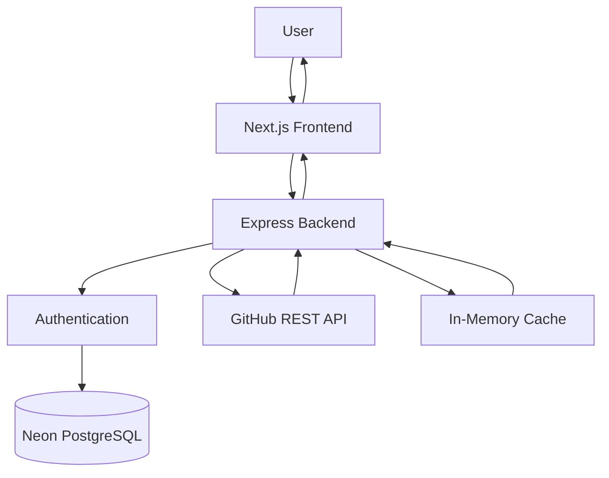

<div align="center">

# 🐙 GitHub Follower Tracker

**Explore GitHub profiles, track follower stats, and browse paginated follower lists with each follower's own follower count.**

[](https://github-follower-tracker-one.vercel.app/)
[](https://github-follower-tracker-37rs.onrender.com/)


</div>

---

## 🔍 Overview

GitHub Follower Tracker is a full-stack web application built with **Next.js, TypeScript, Node.js, Express.js, and PostgreSQL**. It integrates with the **GitHub REST API** and uses caching, request deduplication, and concurrency control to keep external API usage efficient.

Search any public GitHub username, see their total follower count, and browse their followers page by page. Each follower entry shows their username, their own follower count, and a direct link to their GitHub profile.

<!-- 📸 Add a screenshot or GIF of your app here:
<p align="center">
  
</p>
-->

## ✨ Features

| | Feature | Description |
|---|---|---|
| 🔎 | **Profile Search** | Search any public GitHub username |
| 📊 | **Follower Statistics** | View a profile's total follower count |
| 📄 | **Paginated Followers** | Browse followers page by page |
| 🔢 | **Follower Counts** | See how many followers each listed user has |
| 🔗 | **Profile Links** | Jump directly to any follower's GitHub profile |
| 🔐 | **Authentication** | Register, sign in, keep sessions, and sign out |
| 🗄️ | **Database Integration** | User and session data stored in PostgreSQL |
| ⚡ | **In-Memory Caching** | TTL-based cache for previously fetched data |
| 🔁 | **Request Deduplication** | Identical simultaneous requests share one GitHub call |
| 🚦 | **Concurrency Control** | Limits parallel follower-profile requests |
| ✅ | **Input Validation** | Zod-validated usernames and pagination params |
| 🛡️ | **Error Handling** | Handles invalid usernames, GitHub API failures, and unexpected errors |

## 🧰 Tech Stack

| Layer | Technologies |
|---|---|
| **Frontend** | Next.js, React, TypeScript, Tailwind CSS, TanStack Query |
| **Backend** | Node.js, Express.js, JavaScript, Zod |
| **Database** | PostgreSQL (Neon) |
| **Optimization** | JavaScript `Map` cache, TTL expiration, in-flight deduplication, concurrency control |
| **Testing** | Vitest, Supertest |
| **Tools & Hosting** | Git, GitHub, VS Code, Postman, Vercel, Render |

## 🏗️ Architecture

The app follows a client-server architecture.



### Application Flow

1. The user signs in to the application.
2. The frontend sends authenticated requests to the Express backend.
3. The user enters a GitHub username.
4. The backend retrieves the GitHub profile information.
5. The user requests a particular followers page.
6. The backend checks the cache before making external API requests.
7. On a cache miss, the backend fetches followers from GitHub.
8. Individual follower profiles are fetched with controlled concurrency.
9. Processed results are cached and returned to the frontend.
10. The frontend displays follower information with pagination.

## 📡 API Reference

### `GET /api/github/:username`

Returns profile information for a GitHub user.

```http
GET /api/github/torvalds
```

```json
{
  "username": "torvalds",
  "totalFollowers": 329561
}
```

### `GET /api/github/:username/followers`

Returns a page of followers for a GitHub user.

| Parameter | Default | Constraints | Description |
|---|---|---|---|
| `page` | `1` | Positive integer | Page number |
| `limit` | `5` | 1–100 | Followers per page |

```http
GET /api/github/torvalds/followers?page=1&limit=5
```

```json
{
  "username": "torvalds",
  "page": 1,
  "limit": 5,
  "data": [
    {
      "username": "example-user",
      "followersCount": 120,
      "profileUrl": "https://github.com/example-user"
    }
  ]
}
```

> 💡 Response values are illustrative. Follower counts change over time.

## ⚡ Performance Optimizations

### 1. In-Memory Caching

A JavaScript `Map` caches follower data to avoid repeated GitHub requests.

| Setting | Value |
|---|---|
| Cache TTL | 60 seconds |
| Maximum entries | 500 |

- **Cache HIT:** returns previously stored data.
- **Cache MISS:** fetches fresh data from GitHub and stores it.
- Expired entries are removed on access or during cleanup.
- The oldest entries are evicted when the cache reaches capacity.

### 2. In-Flight Request Deduplication

An `inFlightRequests` Map tracks requests currently being processed. If identical requests arrive at the same time, later ones reuse the existing Promise instead of triggering duplicate GitHub API calls.

### 3. Concurrency Control

A custom `mapWithConcurrency()` helper limits how many follower-profile requests run at once, smoothing out request bursts.

```javascript
const MAX_CONCURRENT_REQUESTS = 5;
```

### 4. Input Validation

[Zod](https://zod.dev/) validates all incoming parameters:

- Non-empty GitHub usernames, up to 39 characters
- Supported GitHub username format
- Positive integer page numbers
- Page limits between 1 and 100

Invalid requests return appropriate HTTP error responses.

## 🔐 Authentication & Database

- User registration and sign-in
- Session-based authentication using cookies
- Authenticated API requests and sign-out
- User and session records stored in **Neon PostgreSQL**

Database credentials and session secrets live in environment variables and are never exposed to the frontend.

## 📁 Project Structure

```text
github-follower-tracker/
├── backend/
│   ├── server.js          # Express app and routes
│   ├── index.js           # Entry point
│   ├── db.js              # PostgreSQL connection
│   ├── server.test.js     # Vitest + Supertest tests
│   ├── package.json
│   └── .env               # Not committed
│
├── frontend/
│   ├── src/app/
│   │   ├── dashboard/
│   │   ├── sign-in/
│   │   ├── sign-up/
│   │   ├── layout.tsx
│   │   └── globals.css
│   ├── public/
│   └── package.json
│
└── README.md
```

## 🚀 Getting Started

### Prerequisites

- Node.js v22 (or compatible)
- npm
- Git
- A [Neon](https://neon.tech/) PostgreSQL database

### 1. Clone the repository

```bash
git clone https://github.com/Swaroop2006/github-follower-tracker.git
cd github-follower-tracker
```

### 2. Set up the backend

```bash
cd backend
npm install
```

Create `backend/.env`:

```env
PORT=3000
DATABASE_URL=your_neon_database_connection_string
SESSION_SECRET=your_session_secret
```

> ⚠️ Never commit your `.env` file.

Start the server:

```bash
npm start
```

The backend runs at `http://localhost:3000`. Visiting it should return:

```text
GitHub Follower Tracker API is running!
```

### 3. Set up the frontend

In a new terminal:

```bash
cd frontend
npm install
```

Create `frontend/.env.local`:

```env
NEXT_PUBLIC_API_URL=http://localhost:3000
```

Start the dev server on port 3001 (so it doesn't clash with the backend):

```bash
npm run dev -- -p 3001
```

Open **http://localhost:3001** in your browser.

## 🧪 Running Tests

The backend is tested with Vitest and Supertest, covering API behavior, validation, error handling, and caching.

```bash
cd backend
npm test
```

## ☁️ Deployment

| Component | Platform | Responsibility |
|---|---|---|
| Frontend | [Vercel](https://vercel.com/) | Next.js hosting |
| Backend | [Render](https://render.com/) | Express API hosting |
| Database | [Neon](https://neon.tech/) | PostgreSQL hosting |

**Live links**

- 🌐 Application: https://github-follower-tracker-one.vercel.app/
- ⚙️ Backend: https://github-follower-tracker-37rs.onrender.com/

## 📚 Key Learnings

- Building REST APIs with Node.js and Express.js
- Integrating external APIs over HTTP
- Implementing pagination and input validation
- Caching strategies and TTL
- Handling concurrent requests and Promise-based workflows
- Request deduplication
- PostgreSQL and database-backed sessions
- Automated testing with Vitest and Supertest
- Building a frontend with Next.js and TypeScript
- Deploying a full-stack app across Vercel, Render, and Neon

---

<div align="center">

**Built as a hands-on full-stack learning project.**

If you find it interesting, consider giving the repo a ⭐

</div>
